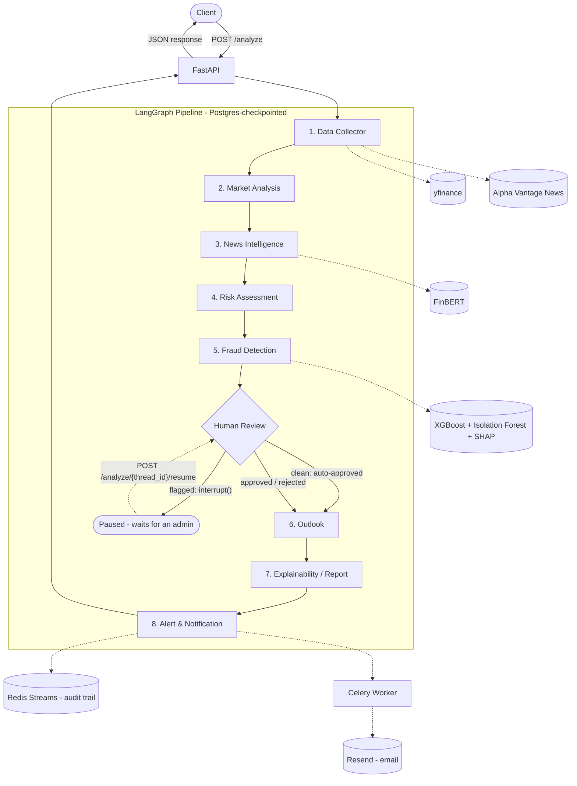

# FinGuardian AI

An 8-agent, LangGraph-orchestrated market analysis backend. It turns public market data and news into an explainable, human-reviewed **analysis outlook** for a stock symbol, behind a JWT-authenticated FastAPI service with a Streamlit dashboard.

> **Educational project - not investment advice.** FinGuardian AI is an academic prototype that summarises public data. It does not recommend that anyone buy, sell or hold any security, and it is not registered with SEBI or any other financial regulator. See [Scope and disclaimer](#scope-and-disclaimer).

Built as a B.Tech CSE capstone project.

## Table of Contents

- [Scope and disclaimer](#scope-and-disclaimer)
- [Overview](#overview)
- [Architecture](#architecture)
- [Roles and human review](#roles-and-human-review)
- [Frontend](#frontend)
- [Tech Stack](#tech-stack)
- [Project Structure](#project-structure)
- [Prerequisites](#prerequisites)
- [Setup](#setup)
- [Environment Variables](#environment-variables)
- [Running the Application](#running-the-application)
- [API Reference](#api-reference)
- [Testing and CI](#testing-and-ci)
- [Known Environment Notes](#known-environment-notes)
- [Roadmap](#roadmap)

## Scope and disclaimer

**What this project is.** An educational, automated analysis of public market data. For a given symbol it reports measurable conditions - price momentum, volatility, news sentiment, a rule-based risk score, and an anomaly screen - and summarises them as an *analysis outlook*: **positive signals**, **mixed signals** or **negative signals**. The outlook describes what the data shows. It never tells anyone to act.

**What this project is not.**
- It is not investment advice, a research report, or a recommendation to buy, sell or hold any security.
- It does not personalise anything: no portfolios, goals, risk profiles or suitability checks.
- It is not registered with SEBI (India) or any other financial regulator, and it is not offered for a fee.
- It is not a trading system. Do not base financial decisions on it.

**Known limitations.**
- The fraud / anomaly models (XGBoost + Isolation Forest) are trained on **synthetic data generated at startup**. They have not been validated against real market-manipulation cases, so their output is a demonstration of the technique, not evidence of anything.
- The risk score is a transparent, hand-weighted heuristic. It has not been backtested or validated as a predictor of anything.
- Sentiment comes from FinBERT applied to short news summaries from a free API. Data from free sources can be delayed, incomplete or wrong.
- Only large US-listed symbols have been exercised.

**Regulatory note.** In India, investment advice and research analysis are regulated activities. This repository is shared as a non-commercial academic prototype. If you plan to run it publicly or commercially, take your own legal advice first.

**Data terms.** Market data comes from `yfinance`, an unofficial wrapper around Yahoo Finance endpoints that its authors describe as intended for research and personal use, and from Alpha Vantage's free API. Review both providers' terms before deploying or commercialising anything built on this.

## Overview

A client sends `POST /analyze` with a stock symbol. Behind that single request, eight coordinated agents run in sequence: pulling live market and news data, scoring sentiment, assessing risk, screening for anomalies, pausing for a human reviewer when warranted, summarising the signals into an outlook, writing a plain-English report, and dispatching an alert if needed. Every run is checkpointed in Postgres via LangGraph, so a paused case survives a server restart and can be resumed later with a single API call.

## Architecture



**State** flows through all nodes as a single typed `AgentState`, checkpointed to Postgres after every node via `AsyncPostgresSaver`. Fields use LangGraph reducers where they should accumulate (`agent_log`, `alerts_sent`) and plain overwrite where only the latest value matters.

### The agents

| # | Agent | Responsibility |
|---|-------|-----------------|
| 1 | Data Collector | Fetches market data (yfinance) and news headlines (Alpha Vantage), publishes a completion event to Redis Streams |
| 2 | Market Analysis | Computes price change %, 5-day volatility, 5-day range and momentum |
| 3 | News Intelligence | Scores each article with FinBERT and aggregates to one confidence-weighted sentiment score |
| 4 | Risk Assessment | Combines volatility, sentiment and momentum into a transparent 0-100 risk score with named factors |
| 5 | Fraud Detection | XGBoost and Isolation Forest screen the case; SHAP explains which features drove the score |
| - | Human Review | Pauses the graph for flagged cases via `interrupt()`; clean cases pass straight through |
| 6 | Outlook | Summarises risk, momentum, sentiment and any human decision as positive / mixed / negative signals. Describes conditions only |
| 7 | Explainability / Report | Assembles every agent's output into one readable report, translating SHAP values into plain language, with the disclaimer attached |
| 8 | Alert & Notification | Decides alert severity (critical / warning / none), records it on a Redis Stream, and dispatches an email through a Celery task |

## Roles and human review

- **Users** can run analyses and see their own history. They cannot approve or reject flagged cases.
- **Admins** (analysts) see a queue of flagged cases from *other* users and approve or reject them.
- **Separation of duties** is enforced on the server: an admin cannot review a case they submitted themselves (the API returns `403`), and the review queue excludes their own submissions.
- A human decision always overrides the models: a rejected case always produces negative signals.

## Frontend

A multi-page Streamlit app in `streamlit_app/`:

| Page | Purpose |
|---|---|
| Home | Login / register (registration requires acknowledging the disclaimer), activity summary |
| Analyze | Run the pipeline for a symbol and view the report |
| History | Your past analyses, with full detail |
| How It Works | Plain-language explanation of the pipeline, alerts, and the scope of the project |
| Admin Review | Cross-user queue of flagged cases (admins only) |

The frontend has its own small `requirements.txt` and talks to the API only over HTTP (`API_BASE_URL`), so it can be deployed separately from the backend.

## Tech Stack

- **API:** FastAPI, Uvicorn, Nginx (reverse proxy + rate limiting), slowapi (per-endpoint limits)
- **Agent orchestration:** LangGraph with Postgres-backed checkpointing
- **Auth:** JWT + bcrypt, role-based access control
- **Database:** PostgreSQL (`pgvector/pgvector` image) via SQLAlchemy (async) + Alembic
- **Event bus / task queue:** Redis Streams, Celery
- **ML:** FinBERT (`ProsusAI/finbert`), XGBoost, scikit-learn `IsolationForest`, SHAP
- **External data:** yfinance, Alpha Vantage News & Sentiment API
- **Email:** Resend
- **Frontend:** Streamlit
- **Tooling:** pytest, GitHub Actions CI, Docker Compose

## Project Structure

```
finguardian-ai/
├── .github/workflows/tests.yml   # CI: pytest against a real Postgres service
├── alembic/                      # migrations (env.py excludes LangGraph's checkpoint tables)
├── app/
│   ├── agents/
│   │   ├── state.py              # shared AgentState
│   │   ├── data_collector.py
│   │   ├── market_analysis.py
│   │   ├── news_intelligence.py
│   │   ├── risk_assessment.py
│   │   ├── fraud_features.py     # fraud_detection_node lives here
│   │   ├── human_review.py
│   │   ├── outlook.py
│   │   ├── report.py
│   │   └── alert_notification.py
│   ├── events/redis_client.py
│   ├── disclaimer.py             # single source for disclaimer text
│   ├── graph.py                  # single source of truth for graph wiring
│   ├── main.py                   # FastAPI app and routes
│   ├── celery_app.py, tasks.py
│   ├── config.py, database.py, models.py, schemas.py
│   └── security.py, dependencies.py
├── streamlit_app/                # Streamlit frontend (own requirements.txt)
├── tests/                        # pytest suite
├── nginx/nginx.conf
├── docker-compose.yml
└── requirements.txt
```

## Prerequisites

- Python 3.11, Docker Desktop, Git
- A free [Alpha Vantage](https://www.alphavantage.co/support/#api-key) API key (25 requests/day)
- A free [Resend](https://resend.com/signup) API key

## Setup

```bash
git clone https://github.com/Nandini-m05/finguardian-ai.git
cd finguardian-ai

python -m venv venv
venv\Scripts\activate        # Windows
# source venv/bin/activate   # macOS/Linux

pip install -r requirements.txt
```

Create a `.env` file (see below), then start the containers and apply migrations:

```bash
docker compose up -d
alembic upgrade head
```

## Environment Variables

| Variable | Required | Notes |
|---|---|---|
| `APP_ENV` | No (default `development`) | |
| `DATABASE_URL` | Yes | Application Postgres connection string (`postgresql+asyncpg://...`) |
| `LANGGRAPH_DB_URL` | Yes | LangGraph checkpoint connection string - must be psycopg-style (`postgresql://...`) |
| `JWT_SECRET` | Yes | |
| `JWT_ALGORITHM` | No (default `HS256`) | |
| `JWT_EXPIRE_MINUTES` | No (default `60`) | |
| `REDIS_URL` | No (default `redis://localhost:6379`) | |
| `ALPHA_VANTAGE_API_KEY` | Yes | Free tier: 25 requests/day |
| `RESEND_API_KEY` | Yes | |
| `ALERT_RECIPIENT_EMAIL` | Yes | Until a domain is verified with Resend, this must be the address the Resend account was created with |

The Streamlit app reads one optional variable, `API_BASE_URL` (default `http://localhost:8000`).

## Running the Application

Four long-lived processes, each in its own terminal:

```bash
docker compose up -d                                          # Postgres, Redis, Nginx
uvicorn app.main:app --reload                                 # API
celery -A app.celery_app worker --loglevel=info --pool=solo   # alert delivery worker
streamlit run streamlit_app/app.py                            # dashboard
```

> `--pool=solo` is required on Windows, where Celery's default `fork()`-based pool is unavailable. Celery workers do not hot-reload: restart the worker after changing `tasks.py`.

To create an admin, register an account and then promote it in the database:

```sql
UPDATE users SET role = 'admin' WHERE email = 'you@example.com';
```

Log out and back in afterwards so the app picks up the new role.

## API Reference

Interactive docs: `http://localhost:8000/docs`. Authenticated routes expect `Authorization: Bearer <token>`.

| Method | Path | Auth | Description |
|---|---|---|---|
| `POST` | `/register`, `/login` | No | Create an account / get a JWT |
| `GET` | `/me` | Yes | Current user, including role |
| `POST` | `/analyze` | Yes (5/min) | Run the full pipeline for a symbol |
| `GET` | `/analyses` | Yes | Your own analysis history |
| `GET` | `/analyses/{thread_id}` | Yes | Full detail (your own; any if admin) |
| `POST` | `/analyze/{thread_id}/resume` | Admin | Approve or reject a flagged case (not your own) |
| `GET` | `/admin/pending-reviews` | Admin | Flagged cases from other users |
| `GET` | `/health` | No | Health check |

**Example response from `POST /analyze`** (abridged):

```json
{
  "thread_id": "analysis-f43a93f8",
  "status": "completed",
  "symbol": "AAPL",
  "risk_score": 27.9,
  "risk_factors": ["Elevated price volatility (2.63)"],
  "fraud_flag": false,
  "requires_human_review": false,
  "human_decision": "approved",
  "outlook": "positive_signals",
  "outlook_rationale": "AAPL: risk score 27.9/100, up momentum, sentiment +0.19 -> positive signals.",
  "final_report": "FinGuardian AI Analysis Report - AAPL\n...",
  "alerts_sent": [],
  "disclaimer": "FinGuardian AI is an educational, automated analysis of public market data. ..."
}
```

When a case is flagged, `status` is `"pending_review"` and an admin resolves it through the resume endpoint.

## Testing and CI

```bash
pytest -v
```

The suite (28 tests) covers technical-indicator maths (including a NaN regression test), risk scoring against hand-calculated values, the outlook logic, alert severity rules, report generation, graph wiring, and API authentication. Two tests deserve a mention: one asserts that a human rejection always overrides the models, and one asserts that the outlook engine never emits advice language (buy / sell / hold / avoid / recommend).

GitHub Actions runs the suite on every push against a real Postgres service. A real end-to-end `/analyze` call is deliberately excluded, since it would spend an Alpha Vantage request on every run; that path is verified manually.

## Known Environment Notes

- **`WindowsSelectorEventLoopPolicy`** is required before any `asyncio` code runs on Windows: `psycopg`'s async driver is incompatible with the default `ProactorEventLoop`.
- **Windows Smart App Control** can block newly installed compiled packages with an `Application Control policy has blocked this file` error. Turning it off is a one-way setting.
- **Alembic and LangGraph:** `AsyncPostgresSaver.setup()` creates its checkpoint tables outside SQLAlchemy. The `include_object` filter in `alembic/env.py` stops `--autogenerate` from generating a migration that drops them.
- **Streamlit session state** is set once at login. A role change made in the database needs a logout/login to take effect.
- **Keep `requirements.txt` fresh.** A local virtualenv hides missing entries; CI does not.

## Roadmap

- [x] Automated pytest suite and GitHub Actions CI
- [x] Streamlit dashboard with history and admin review queue
- [x] Analysis-outlook framing, scope and disclaimer
- [ ] Public showcase and/or hosted demo
- [ ] MinIO storage for generated reports
- [ ] Observability stack (Prometheus, Grafana, OpenTelemetry, Loki)
- [ ] Verified sending domain for Resend
- [ ] Open-source LICENSE
